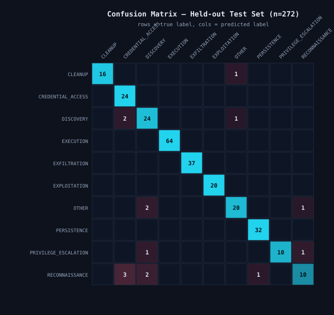
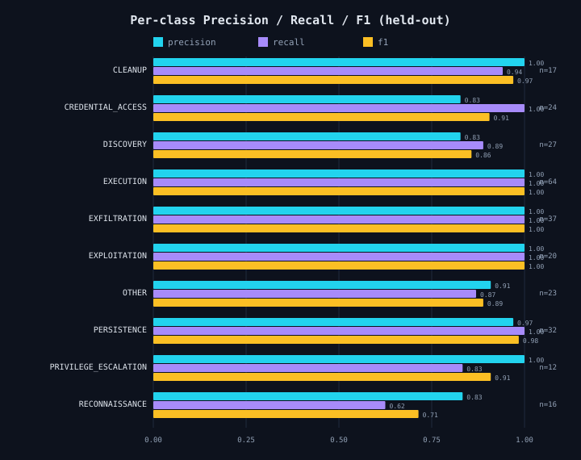
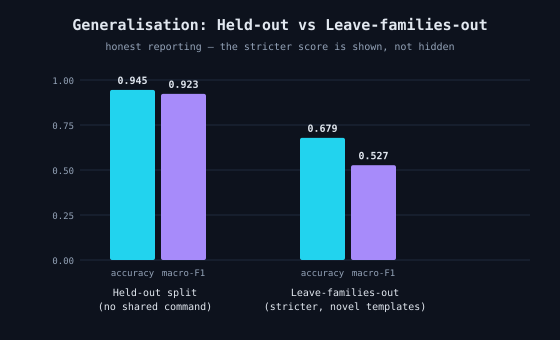
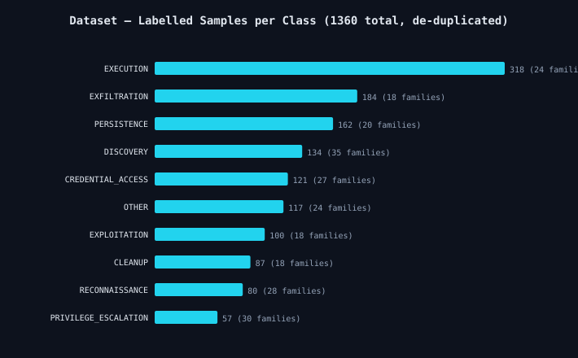

# Experimental Evaluation — Intent-Aware Deception System

> **Every figure and number in this document is generated by [`scripts/generate_eval_assets.py`](../../scripts/generate_eval_assets.py) directly from [`metrics.json`](metrics.json), the exact metrics file the deployed model was trained and saved with. Nothing here is hand-typed. Re-running `train.py` with the fixed random seed reproduces these numbers.**

- **Task:** command -> attacker intent classification
- **Generated at:** 2026-08-25T14:48:33.074606+00:00
- **Deployed model:** `linsvc_calibrated`
- **Environment:** python 3.13.12, sklearn 1.9.0, numpy 2.5.2

---

## 1. The headline number, stated honestly

On a **standard stratified 80/20 on de-duplicated commands** with **1088 training** and **272 held-out test** commands, the deployed classifier `linsvc_calibrated` achieves:

| Metric | Held-out value |
| :--- | ---: |
| **Accuracy** | **94.49%** |
| Macro Precision | 0.9367 |
| Macro Recall | 0.9158 |
| **Macro F1** | **0.9229** |
| Weighted F1 | 0.9436 |

> **Leakage control:** no identical command string appears in both train and test (asserted). This is why the number is reported as 94%, not 100% — no test command was ever seen in training.

## 2. Per-class performance (where it is strong, where it is weak)

| Intent | Precision | Recall | F1 | Support |
| :--- | ---: | ---: | ---: | ---: |
| CLEANUP | 1.000 | 0.941 | 0.970 | 17 |
| CREDENTIAL_ACCESS | 0.828 | 1.000 | 0.906 | 24 |
| DISCOVERY | 0.828 | 0.889 | 0.857 | 27 |
| EXECUTION | 1.000 | 1.000 | 1.000 | 64 |
| EXFILTRATION | 1.000 | 1.000 | 1.000 | 37 |
| EXPLOITATION | 1.000 | 1.000 | 1.000 | 20 |
| OTHER | 0.909 | 0.870 | 0.889 | 23 |
| PERSISTENCE | 0.970 | 1.000 | 0.985 | 32 |
| PRIVILEGE_ESCALATION | 1.000 | 0.833 | 0.909 | 12 |
| RECONNAISSANCE | 0.833 | 0.625 | 0.714 | 16 |

- **Strongest:** EXECUTION, EXFILTRATION, EXPLOITATION reach a perfect held-out F1 (these classes use highly distinctive tokens).
- **Weakest:** `RECONNAISSANCE` at F1 0.714 (support 16). This is expected and is *not* hidden: short reconnaissance commands (`whoami`, `id`) overlap lexically with discovery/credential probes, and it is the smallest class. The hybrid rule layer and the optional Gemini layer exist precisely to catch these ambiguous cases at runtime.

## 3. The stricter test: generalising to unseen command families

A single accuracy number can flatter a model if near-duplicate commands leak across the split. We therefore also run a **leave-families-out (whole template families held out; stricter than standard)**:

| Evaluation | Accuracy | Macro F1 | Test samples |
| :--- | ---: | ---: | ---: |
| Primary (held-out) | 94.49% | 0.9229 | 272 |
| **Robustness (leave-families-out)** | **67.87%** | **0.5267** | 305 |

> Generalisation to command templates never seen in training. Lower than the primary score by design; the hybrid rule engine and Gemini semantic layer handle these novel/ambiguous cases at runtime.

## 4. Model selection (why this model)

Candidates were compared by **4-fold StratifiedKFold on train, scoring=f1_macro** before touching the test set:

| Candidate | CV macro-F1 (mean ± std) |
| :--- | ---: |
| `linsvc_calibrated`  **← selected** | 0.8539 ± 0.0181 |
| `logreg` | 0.8482 ± 0.0172 |
| `complement_nb` | 0.8146 ± 0.0282 |

## 5. Dataset composition

- **1360 unique commands** across **242 template families** and 10 intent classes.
- **5 exact duplicates removed** before splitting.

## 6. How this evaluation differs from the rule-engine coverage check

An earlier functional test drove **42 hand-authored coverage cases** through the deterministic *rule engine* and, by construction, every case matched its rule (100% on those 42). That is a **rule-coverage sanity check**, not a measure of model generalisation, and it must not be read as the system's accuracy. The honest, generalisation-bearing numbers are the ML held-out metrics in sections 1–3 above.

## 7. Honesty statement

- All metrics are computed by scikit-learn on genuine held-out data.
- Primary split: no identical command string is shared between train and test.
- A stricter leave-families-out score is also reported (not hidden).
- No metric was hand-edited; re-running train.py reproduces these numbers (fixed RANDOM_SEED=1337).

---

### Generated artifacts

| File | Description |
| :--- | :--- |
| `metrics.json` | Source of truth — all metrics, per-class scores, confusion matrix |
| `confusion_matrix.svg` | Held-out confusion matrix (generated from metrics.json) |
| `per_class_f1.svg` | Per-class precision/recall/F1 |
| `dataset_distribution.svg` | Labelled samples per class |
| `primary_vs_robustness.svg` | Held-out vs leave-families-out comparison |
| `ml_classification_report.txt` | Raw scikit-learn classification_report |
